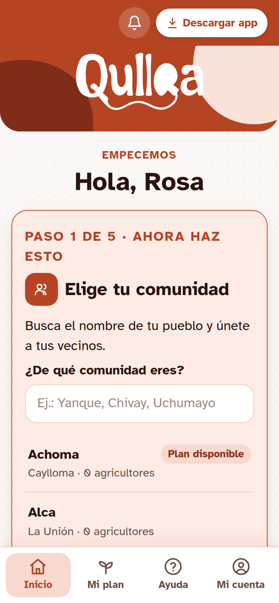
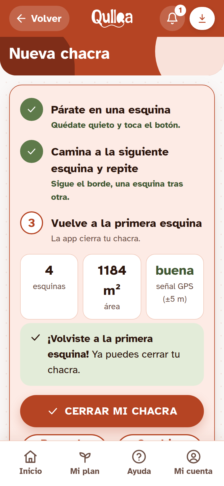
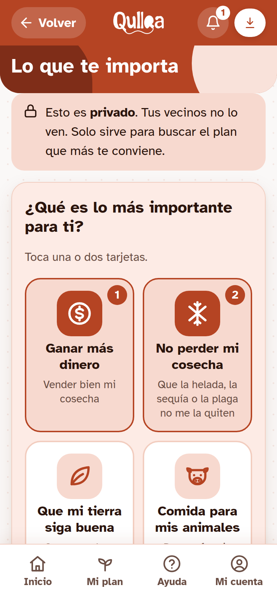
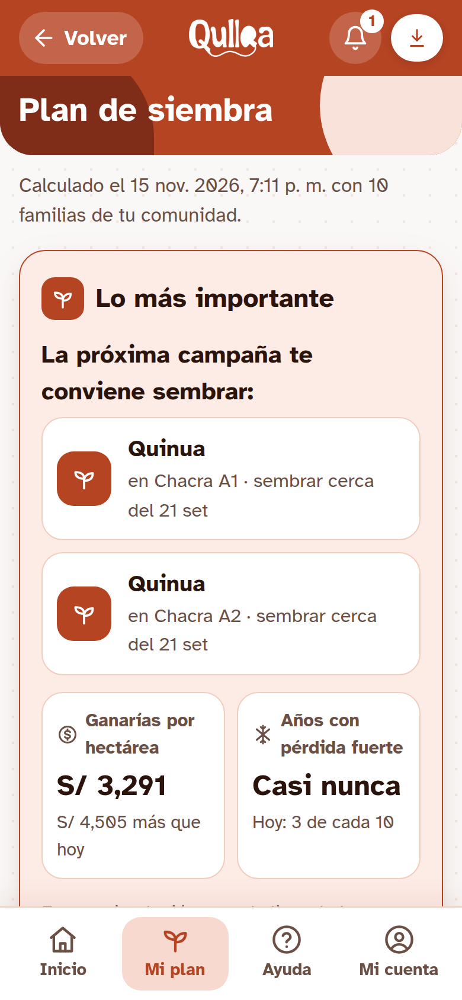
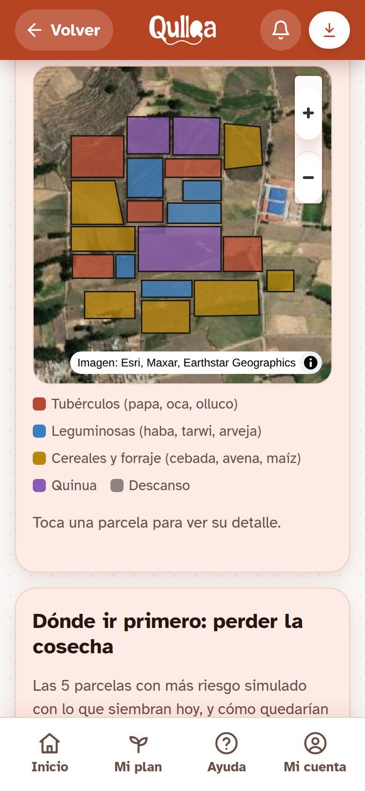
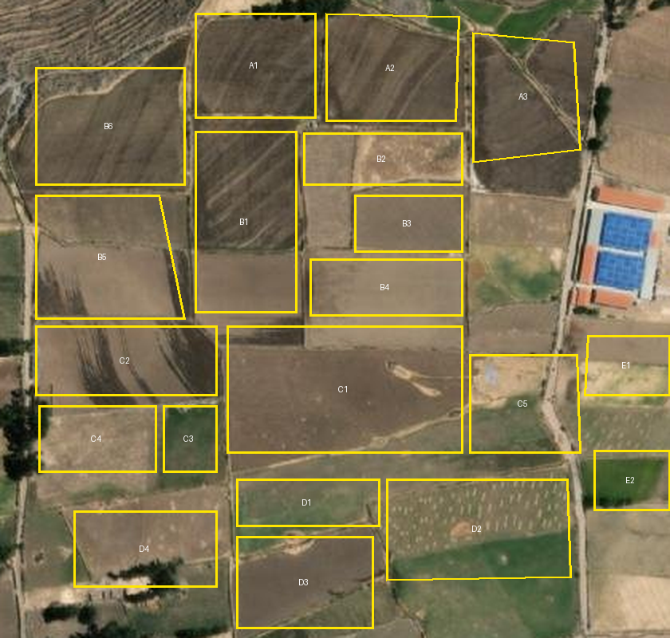

<p align="center">
  
</p>

<h3 align="center">A community digital twin to decide what to plant</h3>

<p align="center">
  NASA Space Apps Challenge 2026 · <b>Live app: <a href="https://qullqa.us">qullqa.us</a></b> ·
  <a href="docs/presentacion/qullqa-presentacion.pptx">Presentation</a> ·
  <a href="docs/ARCHITECTURE.md">Architecture</a>
</p>

> **En español:** Qullqa ayuda a las comunidades campesinas de los Andes a decidir **juntas** qué sembrar, cuándo y con quién. Simula cada rotación posible de cada chacra con 44 años de clima real (NASA POWER, GPM IMERG, MODIS, SRTM) y lo que cada familia observa con su celular, y busca el plan que conviene a toda la comunidad con una regla fija: **ninguna familia queda peor que sembrando sola**. Piloto: corredor Chivay–Yanque–Coporaque, valle del Colca (Arequipa, Perú).

---

## The problem

Smallholder families in the Andes face two gaps:

1. **No rotation plan.** Repeating potato after potato builds up pests and wears out the soil, and very few farmers get technical assistance.
2. **Rotating alone.** Even families who rotate decide without data and without their neighbors: everyone plants last season's winner, prices crash after a glut, pests move from plot to plot and everyone needs irrigation water at the same time.

Both gaps share one root: **each family decides alone, without data.**

## What Qullqa does

<table>
  <tr>
    <td align="center"><br><sub>Guided home: one step at a time</sub></td>
    <td align="center"><br><sub>Mark the plot standing at each corner</sub></td>
    <td align="center"><br><sub>“What matters most?” in plain words</sub></td>
    <td align="center"><br><sub>The plan: what, when, how much</sub></td>
  </tr>
</table>

1. **Each family marks its plots** with the phone's GPS (averaging several readings at each corner) or by drawing on satellite imagery, and records what it planted in the last three seasons.
2. **It says what matters most** by tapping one or two cards: *earn more*, *don't lose the harvest*, *keep the soil good*, *feed my animals*. The server turns that into weights for eight indicators.
3. **Qullqa simulates every three-season rotation** for every plot against 44 years of daily weather (1981–2025): daily FAO-56 soil water balance, frost and heat damage by crop stage, RUSLE erosion, organic matter, nitrogen credit, income and forage.
4. **It finds the community plan**: simulated annealing over all families, penalizing everyone planting the same crop (price drop, shared pests, irrigation peaks, erosion downhill), with individual rationality as a hard constraint: *nobody ends up worse than with their best solo plan*.
5. **Gains are shared fairly** with the Shapley value and expressed as *ayni* (Andean reciprocal work: labor days, water turns, seed).
6. **Every family gets three options** (what it plants today, its best plan alone and the coordinated plan), each with why, evidence, risks to check locally, and a confidence level that says what data is missing to raise it.

The plan is computed automatically, with no "request" button. When a neighbor submits data, the community plan is computed and everyone is notified in the app and on the phone (Web Push). A family that joins a community with an existing plan gets its own plan while its neighbors keep theirs. A family left alone for 3 days gets a personal plan.

## Data

| Data | Product (producer) | Access | Use |
|---|---|---|---|
| Daily weather since 1981 | **NASA POWER** (NASA LaRC) | POWER API | ET0, frost, heat, growing degree days |
| Rainfall | **GPM IMERG V07** (NASA GES DISC) | OPeNDAP + Earthdata | Monthly bias correction of POWER rain (~220 → ~380 mm/yr in Colca) |
| Vegetation and night temperature | **MODIS** MOD13Q1 / MYD11A2 (NASA) | Microsoft Planetary Computer | Phenology, cold-air pooling at each site |
| Terrain | **SRTM** 30 m (NASA) | OpenTopoData | Elevation correction, slope, aspect |
| Soil | SoilGrids (ISRIC, *not NASA*) | REST API | Water holding capacity, erodibility |
| Land cover | ESA WorldCover (*not NASA*) | Planetary Computer | Cropland mask |
| El Niño years | NOAA ONI (*not NASA*) | — | Retrospective test (2015-16) |
| Field observations | Farmers | The app | Frost, harvests, soil moisture, slope, green cover (ExG) |

**Golden rule:** *Qullqa never turns an estimate into a fact, a correlation into a cause, or a simulation into a proven prediction.* Every number carries its provenance (`observed`, `estimated`, `simulated` or `assumed`) and its source. Every editable parameter lives in [`packages/catalog/src/assumptions.ts`](packages/catalog/src/assumptions.ts).

The processed valley dataset is versioned in [`packages/data/fixtures/colca.json`](packages/data/fixtures/colca.json), so **no API key is needed to run the project**.

## Results in simulation

12 synthetic communities × 10 families on **20 real plots in Yanque** (traced on satellite imagery), with real weather from 1981 to 2025. Conservative scenario: potato is also sold in Arequipa, so the local price does not drop.

| Per family, per season | Today | With Qullqa |
|---|---|---|
| Income | S/ 1,725 | **S/ 3,757** |
| Seasons with heavy losses | 3 in 10 | **< 1 in 20** |
| Risk of losing almost everything | 6% | **0.4%** |
| Pest risk index | 31 | **21** |

93 out of 100 families earn more. These are **simulations, not field results**: the families are invented, while the plots and the weather are real. Full data: [`docs/simulacion-mercado-regional.json`](docs/simulacion-mercado-regional.json). Reproduce with `pnpm -F @qullqa/engine exec tsx scripts/simulate-communities.ts 12`.

<p align="center"> &nbsp; </p>
<p align="center"><sub>Admin panel with the demo community and the 20 real plots traced in Yanque</sub></p>

## Architecture

```
apps/
  web/        Installable PWA (React + Vite): farmers, community and admin panel
  api/        Fastify + PostgreSQL/PostGIS: auth, communities, plots, observations, plans, notifications
  worker/     Runs the decision engine on queued plans and sends notifications
packages/
  engine/     Pure decision engine: no I/O, deterministic with a seed, tested
  data/       NASA POWER, GPM IMERG, MODIS (Planetary Computer), SRTM, SoilGrids, WorldCover clients
  catalog/    Crop cards (Andean highland crops) and editable assumptions
  shared/     Shared types and zod schemas
infra/        Docker Compose, Caddy (automatic HTTPS) and deployment scripts
docs/         Architecture, presentation, simulation results, designs
```

Details in [`docs/ARCHITECTURE.md`](docs/ARCHITECTURE.md).

## Run it locally

**Requirements:** Node.js 22+, pnpm 10, Docker.

```bash
git clone <this-repo> qullqa && cd qullqa
pnpm install
cp .env.example .env            # then set JWT_SECRET to a long random string
pnpm infra:up                   # PostgreSQL + PostGIS on localhost:5434
pnpm dev                        # API :3000 · worker · web on http://localhost:5173
```

Open http://localhost:5173 and create an account. The database migrations run automatically when the API starts.

**Demo community.** Put your phone number in `ADMIN_PHONES` in `.env`, restart `pnpm dev`, create an account with that number and open **Panel de administración → Crear la comunidad demo**. Alternatively, run `pnpm -F @qullqa/api seed:demo` while the worker is running. From the panel you can see the plan through the eyes of any demo family.

### Keys and secrets

`.env` is **never committed** (it is in `.gitignore`); `.env.example` lists every variable. **None of the external keys are needed to run the app**, because the valley data is already in the repository.

| Variable | Needed for | How to get it |
|---|---|---|
| `JWT_SECRET` | Sessions (required) | Any long random string, e.g. `openssl rand -hex 32` |
| `ADMIN_PHONES` | Admin panel | Your phone number(s), comma separated |
| `VAPID_PUBLIC_KEY`, `VAPID_PRIVATE_KEY` | Phone notifications (optional) | `cd apps/worker && node -e "console.log(require('web-push').generateVAPIDKeys())"` |
| `EARTHDATA_TOKEN` | Re-downloading GPM IMERG rain (optional) | [urs.earthdata.nasa.gov](https://urs.earthdata.nasa.gov), with *NASA GESDISC DATA ARCHIVE* authorized |
| `PC_SDK_SUBSCRIPTION_KEY` | Higher Planetary Computer limits (optional) | Planetary Computer account |

### Tests

```bash
pnpm typecheck                  # all packages
pnpm -F @qullqa/engine test     # engine: water balance closes to 1e-6, 0 ≤ Yrel ≤ 1, no NaN, provenance, determinism…
pnpm -F @qullqa/api test        # API: privacy between farmers, plan timing, admin, accounts (needs the database)
```

### Refresh the valley data (optional)

```bash
pnpm -F @qullqa/data fetch:colca     # NASA POWER, SRTM, SoilGrids, WorldCover and MODIS (~5 min)
pnpm -F @qullqa/data correct:rain    # GPM IMERG monthly correction (needs EARTHDATA_TOKEN)
```

## Deployment

Production runs on a single VM with the same Docker Compose stack (Caddy with automatic HTTPS, API, worker, PostGIS and a daily database backup): see [`infra/docker-compose.prod.yml`](infra/docker-compose.prod.yml) and [`infra/azure.sh`](infra/azure.sh) (`deploy`, `secrets`, `backup`, `logs`).

## Privacy

What matters to each family, its resources and its vetoes are **private**: the API never returns them to other members. Neighbors only see plot outlines and the shared plan. The admin panel shows anonymous families and averages over at least three families. Photos are processed on the phone, and only the green cover index is uploaded.

## Limitations and next steps

- Field validation with real Colca families; crop prices and yields calibrated with INIA and local markets (frost sensitivity of *cabanita* maize is currently too harsh).
- One crop per season; perennial crops such as alfalfa and price variation by harvest month are not modeled yet.
- More valleys; 30 m vegetation (Landsat / HLS), soil moisture (SMAP), climate scenarios (NEX-GDDP-CMIP6).
- Quechua audio and Play Store distribution.

## License

[MIT](LICENSE)

> *This tool supports decisions; it does not replace the farmer's experience or an agronomist's advice.*
